# ha_openems

Home Assistant integration that interfaces Fenecon FEMS and OpenEMS systems.

[![releasebadge]][release]
[![License][license-shield]](LICENSE)
[![hainstall][hainstallbadge]][hainstall]
[![market][marketbadge]][market]

## Overview

- The integration provides full read and write access to Fenecon and OpenEMS systems. Every property which is accessible or configurable via the regular UI is made available equally in the Home Assistant UI.
- Integration of every backend property, even if not accessible via the regular UI.
- Backend system configuration is made fully visible and accessible to the Home Assistant UI:
  - [Components](https://openems.github.io/openems.io/openems/latest/coreconcepts.html#_openems_component) are made available as Home Assistant service devices.
  - [Channels](https://openems.github.io/openems.io/openems/latest/coreconcepts.html#_channel) are made available as entities.\
     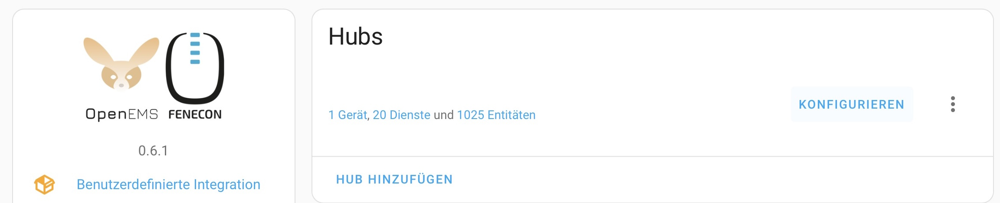
- Pre-configured UI cards for Storage, Charging Station and Optimized Charges apps. These cards are equal in the offered functionality as the regular Fenecon/OpenEMS built-in UI components.
- Works with Fenecon and OpenEMS single and multi-edge systems.
- Advanced configuration options to support non-standard connection types.
- FEMS update discovery and installation option
- Restart option
- Access to REST write App (if installed)

## Table of contents

- [Disclaimer](#disclaimer)
- [Features / Common Use-cases](#features--common-use-cases)
- [Installation](#installation)
- [Configuration](#configuration)

## Disclaimer

- This integration is not affiliated with Fenecon. The developers take no responsibility for anything that happens to your equipment due to this integration. I.e:
  - All component updates triggered from the integration are persisted to the system flash storage. Setting up automations which trigger such actions at high frequency, will lead to flash memory degradation, significantly shortening the lifespan of the card and increase the risk of immediate data corruption.
  - Be careful with controlling entities which are not enabled by default and for which you have not understood their impact.
  - By default, only a few pre-configured channels are enabled per component. However, there is no limitation how many channels can be enabled in parallel. Increasing the number too high numbers (100+), might overload the FEMS system, with unknown functional impact.
  - Functionality might break during FEMS & OpenEMS updates, as Fenecon might change APIs with upcoming version.

## Features / Common Use-cases:

### Energy Dashboard

Use the following entities to configure the Energy Dashboard:

<table>
  <tr><th>Area</th><th>Option</th><th>Component</th><th>Channel</th><th><i>comment</i></th></tr>
  <tr><td rowspan="2">Electricity Grid</td><td>Grid Consumption </td><td>_sum</td><td>GridBuyActiveEnergy</td><td></td></tr>
  <tr><td>Return to Grid </td><td>_sum</td><td>GridSellActiveEnergy</td><td></td></tr>
  <tr><td rowspan="3">Solar Panels</td><td rowspan="3">Solar production </td><td>_sum</td><td>ProductionActiveEnergy</td><td><i>combined view</i></td></tr>
  <tr><td>pvInverter*</td><td>ActiveProductionEnergy</td><td rowspan="2"><i>individual view</i></td></tr>
  <tr><td>charger*</td><td>ActualEnergy</td></tr>
  <tr><td rowspan="4">Home Battery Storage</td><td rowspan="4">Battery systems</td><td>_sum</td><td>EssDcDischargeEnergy</td><td rowspan="2"><i>combined view</i></td></tr>
  <tr><td>_sum</td><td>EssDcChargeEnergy</td></tr>
  <tr><td>ess*</td><td>DcChargeEnergy</td><td rowspan="2"><i>individual view</i></td></tr>
  <tr><td>ess*</td><td>DcDischargeEnergy</td></tr>
</table>

### [Power Flow card plus](https://github.com/flixlix/power-flow-card-plus)

Use the following entities to configure the Power Flow card plus:

<table>
  <tr><th>Area</th><th>Option</th><th>Component</th><th>Channel</th></tr>
  <tr><td>Grid</td><td>Combined</td><td>_sum</td><td>GridActivePower</td></tr>
  <tr><td>Solar</td><td></td><td>_sum</td><td>ProductionActivePower</td></tr>
  <tr><td rowspan="2">Battery</td><td>Combined</td><td>_sum</td><td>EssDischargePower</td></tr>
  <tr><td>State of Charge</td><td>_sum</td><td>EssSoc</td></tr>
  <tr><td>Home</td><td></td><td>_sum</td><td>ConsumptionActivePower</td></tr>
</table>

### Apps (template UI cards)

To use the template cards, do the following:

1. The template cards depend on the following prerequisites (Please install via the marketplace):
   - [Decluttering card](https://github.com/custom-cards/decluttering-card)
   - [Config template card](https://github.com/iantrich/config-template-card)
   - [Button card](https://github.com/custom-cards/button-card)
   - [Template entity row](https://github.com/Lint-Free-Technology/lovelace-template-entity-row) -> THIS IS A FORK, NOT THE DEFAULT REPO!!!
2. Navigate to the dashboard in which you want to use the card
3. Select edit mode (pencil on the top right corner)
4. From the 3-dots menu in the top right corner, select "raw editor"
5. Paste the full contents of [openems_templates.yaml](openems_templates.yaml) before the dashboard contents
6. Go back to regular edit mode
7. add a new user-defined card, using yaml.

#### EV Charging

**Sample Card config**

```
type: custom:decluttering-card
template: evcs_template
variables:
  - system: fems12345
  - evcs_id: 0
  - ctrlevcs_id: 0
```

**Card variables**

- `system`: Set to your FEMS/OpenEMS system name
- `evcs_id`: Set to your EVCS AppID. Eg `0` if your EVCS component is called `evcs0`. Default value: 0
- `ctrlevcs_id`: Set to your CtrlEVCS AppID. Eg `1` if your EVCS component is called `ctrlEvcs1`. Default value: 0

**Card screenshot** (German version)\
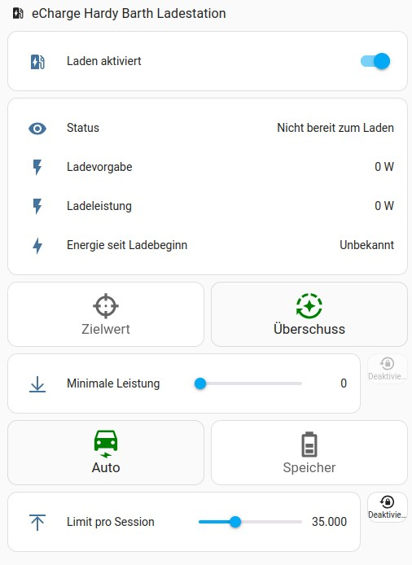

#### Grid Optimized Charge

**Sample Card config**

```
type: custom:decluttering-card
template: optchrg_template
variables:
  - system: fems12345
  - ctrlgridoptimizedcharge_id: 0
```

**Card variables**

- `system`: Set to your FEMS/OpenEMS system name
- `ctrlgridoptimizedcharge_id`: Set to your grid optimized charge AppID. Eg `5` if your optchrg component is called `ctrlGridOptimizedCharge5`. Default value: 0

**Card screenshot** (German version)\
_Note: unapplicable options are automatically hidden and thus not visible in the screenshot_
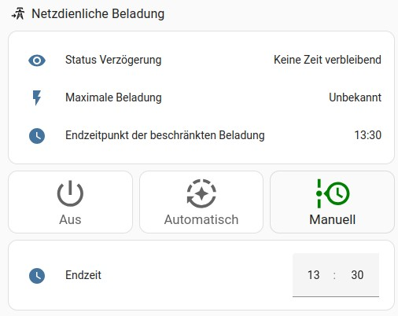

#### Emergency Capacity Reserve

**Sample Card config**

```
type: custom:decluttering-card
template: ess_template
variables:
  - system: fems12345
  - ctrlemergencycapacityreserve_id: 0
```

**Card variables**

- `system`: Set to your FEMS/OpenEMS system name
- `ctrlemergencycapacityreserve_id`: Set to your emergency capacity AppID. Eg `0` if the component is called `ctrlEmergencyCapacityReserve0`. Default value: 0

**Card screenshot** (German version)\
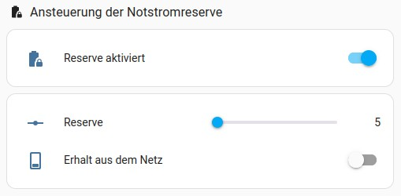

#### Heating Element

**Sample Card config**

```
type: custom:decluttering-card
template: heating_template
variables:
  - system: fems12345
  - ctrlioheatingelement_id: 0
```

**Card variables**

- `system`: Set to your FEMS/OpenEMS system name
- `ctrlioheatingelement_id`: Set to your heating element AppID. Eg `0` if the component is called `ctrlioheatingelement0`. Default value: 0

**Card screenshot** (German version)\
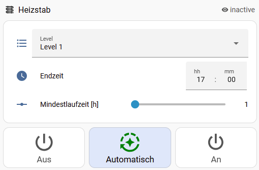

#### SG-Ready Heat Pump

**Sample Card config**

```
type: custom:decluttering-card
template: heatpump_template
variables:
  - system: fems12345
  - ctrlioheatpump_id: 0
```

**Card variables**

- `system`: Set to your FEMS/OpenEMS system name
- `ctrlioheatpump_id`: Set to your heat pump AppID. Eg `0` if the component is called `ctrlIoHeatPump0`. Default value: 0

**Card screenshot** (German version)\
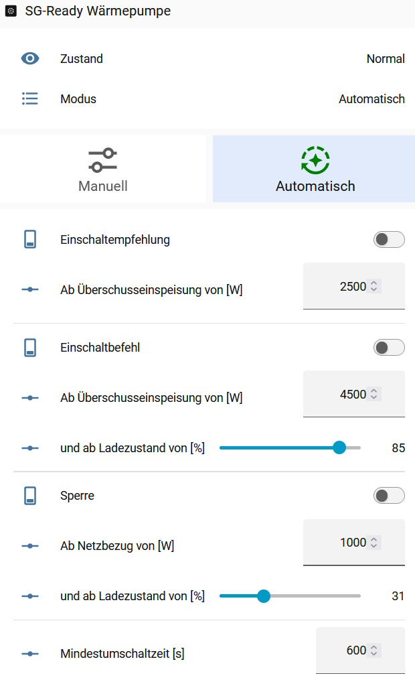

### Detailed battery diagnosis dashboard (component: battery\*)

The integration is supports calculation of additional information, derived from other sensors, which are not provided by FEMS by default.
By that, ΔU calculations for the entire battery system and individual battery modules are provided.
A pre-configured dashboard [battery_diagnosis_dashboard_fems12345.yaml](battery_diagnosis_dashboard_fems12345.yaml) can be used as a starting point for a personal dashboard configuration:
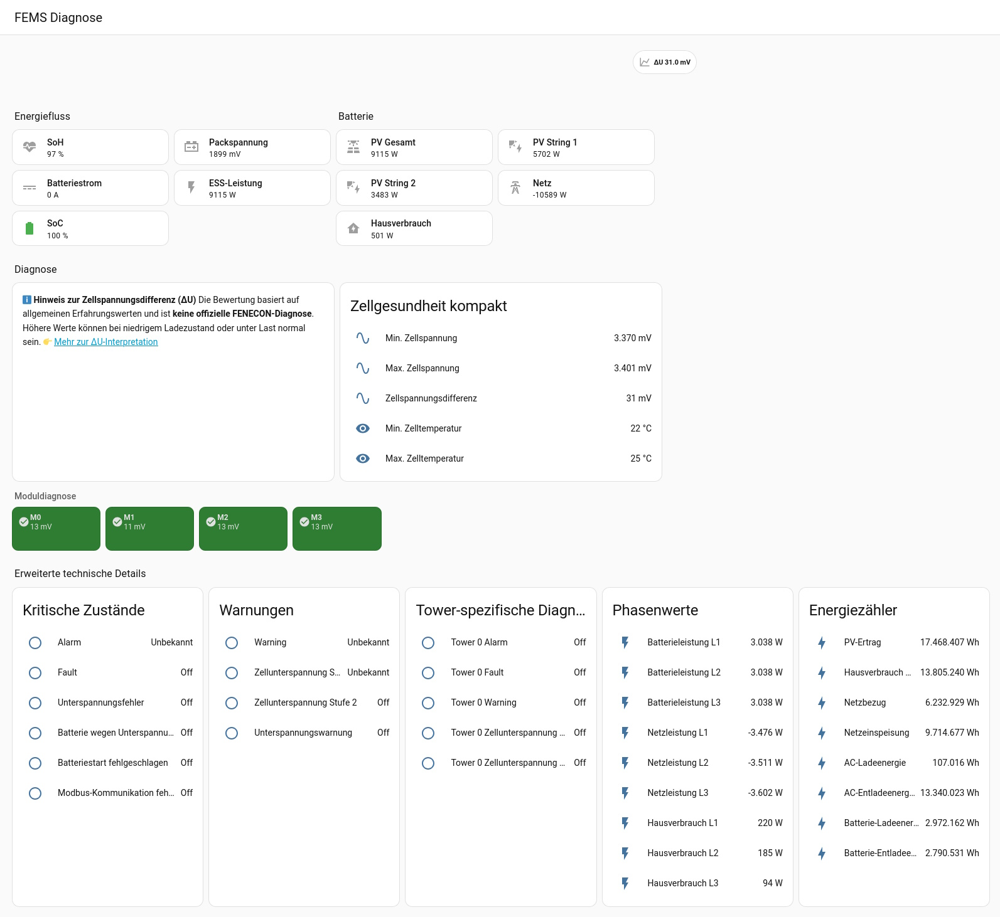

Before using the default dashboard (by copying the files content and pasting it into the dashboard raw yaml editor), please replace all occurrences of the string "fems12345" with the ID of your personal FEMS or openems system.

Furthermore, the dashboard uses the following entities which are to the majority not enabled by default. Before using the dashboard, please enable the components and entities as described in the Configuration chapter further below in this manual.

The dashboard also makes use of the [Mushroom](https://github.com/piitaya/lovelace-mushroom) and [Button card](https://github.com/custom-cards/button-card) UI widgets. In order to use these, please install via the marketplace.

Entities to be enabled, used within the default dashboard configuration:

- **\_sum**
  - `ConsumptionActiveEnergy`, `ConsumptionActivePower`, `ConsumptionActivePowerL1`, `ConsumptionActivePowerL2`, `ConsumptionActivePowerL3`, `EssActiveChargeEnergy`, `EssActiveDischargeEnergy`, `EssActivePower`, `EssActivePowerL1`, `EssActivePowerL1`, `EssActivePowerL3`, `EssDcChargeEnergy`, `EssDcDischargeEnergy`, `GridActivePower`, `GridActivePowerL1`, `GridActivePowerL2`, `GridActivePowerL3`, `GridBuyActiveEnergy`, `GridSellActiveEnergy`, `ProductionActiveEnergy`, `ProductionDcActualPower`
- **battery0**
  - `Current`, `Level1CellUnderVoltage`, `Level2CellUnderVoltage`, `LowMinVoltageFault`, `LowMinVoltageFaultBatteryStopped`, `LowMinVoltageWarning`, `MaxCellTemperature`, `MaxCellVoltage`, `MinCellTemperature`, `MinCellVoltage`, `ModbusCommunicationFailed`, `RunFailed`, `Soc`, `Soh`, `StatusAlarm`, `StatusWarning`, `Tower0Level1CellUnderVoltage`, `Tower0Level2CellUnderVoltage`, `Tower0Module0CellVoltageDifference`, `Tower0Module1CellVoltageDifference`, `Tower0Module2CellVoltageDifference`, `Tower0Module3CellVoltageDifference`, `Tower0PackVoltage`, `Tower0StatusAlarm`, `Tower0StatusFault`, `Tower0StatusWarning`, `VoltageDifference`
- **charger0**
  - `ActualPower`
- **charger1**
  - `ActualPower`

### Additional commonly used components

#### BatteryInverter\*

Contains entities for inverter properties like:

- temperatures of inverter, air, ...
  - `bmspacktemperature`
  - `airtemperature`
  - `radiatortemperature`
- The state of health: `bmssoh`
  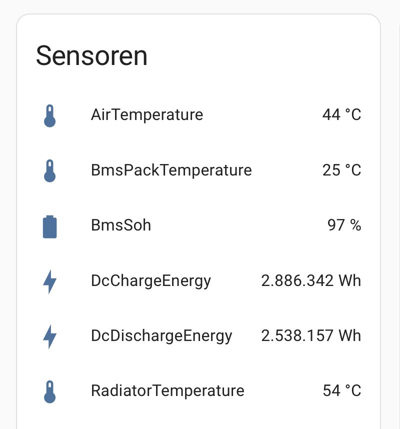

#### meter\*

Here you find the grids frequency.\
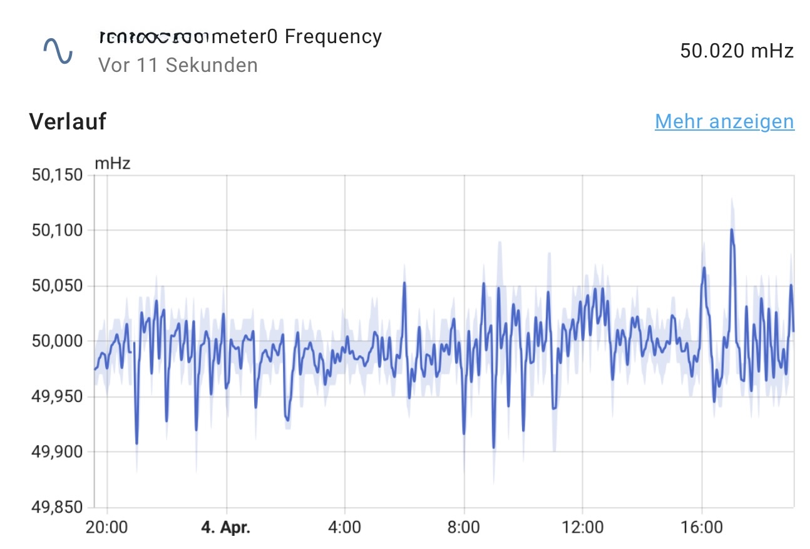

### REST Write App

Channels that can only be written (`"accessMode": "WO"`), e.g. the power setpoints of `ess0` like `SetActivePowerEquals`, are written via the REST API of the edge. This requires the REST app with write access (`Controller.Api.Rest.ReadWrite`). These channels have no entities, as the edge does not report their values.

Use the action **openems.write_channel** with the component device and the channel name:

```yaml
action: openems.write_channel
data:
  device_id: <device id of the component, e.g. ess0>
  channel: SetActivePowerEquals
  value: -2000
  update_cycle: 30
  timeout: 600
```

<table>
  <tr><th>Parameter</th><th>Meaning</th><th>Default value</th></tr>
  <tr><td>device_id</td><td>The component device</td><td></td></tr>
  <tr><td>channel</td><td>The name of the write-only channel</td><td></td></tr>
  <tr><td>value</td><td>The value to write, numbers in the unit of the channel</td><td></td></tr>
  <tr><td>update_cycle</td><td>Writes the value again every given number of seconds. This is necessary because FEMS resets values written via REST after 60 seconds by default. 0 writes the value once.</td><td>0</td></tr>
  <tr><td>timeout</td><td>Stops the repeated writes after the given number of seconds. 0 writes until the same channel is written again or the integration is reloaded.</td><td>0</td></tr>
</table>

In automations, the device action **Write channel** of the component device offers the write-only channels in a list.

_Note: Values written via REST are not reported back by the edge and thus not visible in Home Assistant._

### Update multiple component properties at once

Calling e.g. `switch.turn_on` and `select.select_option` one after the other sends one `updateComponentConfig` request per action.
Use the action **openems.update_component_config** with a component device to send several properties of a component in a single request:

```yaml
action: openems.update_component_config
data:
  device_id: <device id of "fems12345 ctrlEvcs0">
  properties:
    enabledCharging: true
    chargeMode: force_charge
```

Property names are the component configuration names (e.g. `chargeMode`) or channel names (e.g. `_PropertyChargeMode`). Values are given like in the corresponding entities: options of selects in snake_case, numbers scaled like the number entity, times as `HH:MM`. Number limits are not checked.

In the automation editor, the same is available as device action "Update component configuration", which offers one field per property of the selected component.

## Installation

For installation, select "Fenecon FEMS & OpenEMS" integration directly from the home assistant marketplace.

## Configuration

Navigate to Settings -> Devices & Services -> Integrations. Click "Add Integration" and select "Fenecon FEMS & OpenEMS" from the list.

### Main configuration dialog

Enter your connection details:
Parameter | Description
------ | ----------
Host | The hostname or IP address of your Fenecon or OpenEMS system. E.g. `fems12345` or `192.168.1.100`
Username | The username to access the system. Use `x` for local monitoring access. For FEMS online monitoring, your Email address is used as username
Password | For local monitoring of FEMS systems, common values are `user` (read-only access) or `owner` (write access)
Connection Type<br> | Choose 1 of the 5 supported connection types:<br><li>FEMS local monitoring (port 80)</li><li>OpenEMS local monitoring (port 8082)</li><li>Direct edge Websocket connection (port 8085). This is the standard connection type and preselected by default</li><li>Fenecon online monitoring at portal.fenecon.de (hostname option will not be used)</li><li>Custom Websocket URL (hostname option will not be used)</li>
Custom URL\* | Custom Websocket URL, eg: `ws://192.168.1.100:8888/websocket`

\*Options _Connection Type_ and _Custom URL_ are visible only after expanding the **More options** section.

#### Advanced options

In order to change advanced options, start the options flow by selecting the Configure option right next to the config entry name:

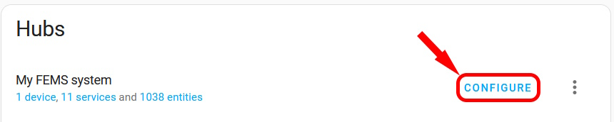
Afterwards, a dialog will appear which allows to change advanced options. The following options are available currently:

| Parameter                             | Description                                                                                                                                                                                                                                                    |
| ------------------------------------- | -------------------------------------------------------------------------------------------------------------------------------------------------------------------------------------------------------------------------------------------------------------- |
| Ignore decreasing if total increasing | For entities which are reported with state class "Total increasing", drop values from the backend which are smaller than the current value.                                                                                                                    |
| Limit data updates                    | In order to reduce the amount of recorder data and the overall system load, this option allows to reduce the update frequency of entity values. Value in seconds. Zero means, values are published immediately after being received (typically 1x per second). |

#### Selection of components and channels to be integrated

Each component of the configured system is represented by a device. After setting up the config entry, a [default list](https://github.com/Lamarqe/openems-client/blob/main/src/openems_client/config/primary_channels.json) of the openems-client library defines which components and entities are enabled. Devices of components outside of this list are disabled, and no entities are created for them. Entities of enabled components which are not in the list are disabled by default.

In order to add or remove the entities of a component, enable or disable its device: open the devices of the config entry (depending on your system configuration, there can be 20 to 50 of them), select a device and enable or disable it in the device settings. Home Assistant then reloads the integration, which creates or removes the entities of the component.

#### Select entities that will be active in Home Assistant

Also for enabled components, most of the entities created are disabled by default. In order to adjust the selection, click the entities number of the config entry ("1038 entities" in the screenshot above).
This will open the entities dialog. In this dialog, (1) activate multi-select, (2) select the entities you want to enable or disable, then (3) enable / disable the selected items via the 3 dot menu on the top right:

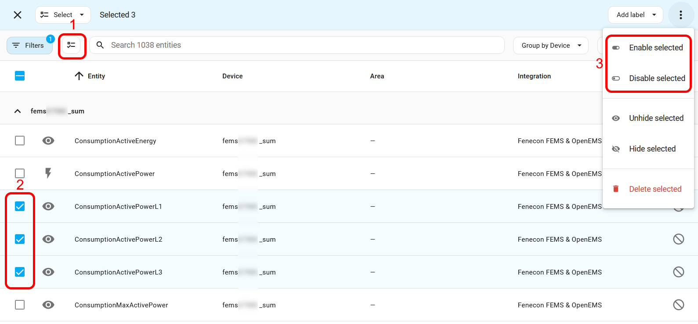
**Only enabled entities will be subscribed in the backed!**

#### Check the backend for configuration changes, change connection details

The list of components and channels is read from the backend once and then cached, so that the integration starts quickly. After each start, the integration reads the components and channels again in the background. If components or channels were added, removed or changed, it updates the cache and reloads. To check for changes immediately, e.g. after a software update or when new battery modules were installed, select **Reload** in the menu of the config entry.

In case the connection details shall be adjusted, select the 3 dots next to the config entry and select **Reconfigure** from the resulting menu. This will bring up the main config dialog and allow you to make all necessary changes. After a reconfiguration, the components and channels are read again as well.

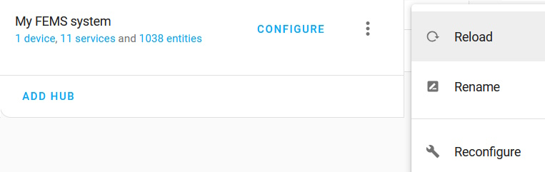

[license-shield]: https://img.shields.io/github/license/Lamarqe/ha_openems.svg?style=for-the-badge
[release]: https://github.com/Lamarqe/ha_openems/releases
[releasebadge]: https://img.shields.io/github/v/release/Lamarqe/ha_openems?style=for-the-badge
[hainstall]: https://my.home-assistant.io/redirect/config_flow_start/?domain=openems
[hainstallbadge]: https://img.shields.io/badge/dynamic/json?style=for-the-badge&logo=home-assistant&logoColor=ccc&label=usage&suffix=%20installs&cacheSeconds=15600&url=https://analytics.home-assistant.io/custom_integrations.json&query=$.openems.total
[market]: https://my.home-assistant.io/redirect/marketplace_browse/?search=openems
[marketbadge]: https://img.shields.io/badge/Marketplace-Default-green.svg?style=for-the-badge
